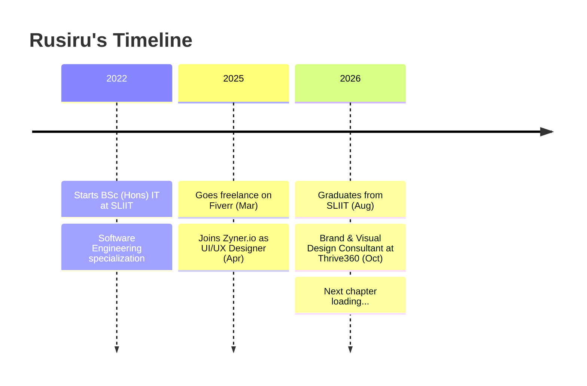

<!-- ═══════════════ HEADER ═══════════════ -->

 

  

  

 

<!-- ═══════════════ ABOUT ═══════════════ -->

## 👋 &nbsp;Hey, I'm Rusiru

> *"Good design is invisible. Great design is felt."*

I'm a **UI/UX & Product Designer** who actually understands the code behind the pixels. I just **graduated with a BSc (Hons) in IT, specializing in Software Engineering from SLIIT** (Aug 2026), so when I hand off a design, developers smile instead of sigh. 😄

I turn messy ideas into **clean flows, sharp interfaces and prototypes that feel alive**, from brand identities to full products, from Figma to live Framer sites.

<table>
<tr>
<td width="50%" valign="top">

### 🧭 Right now
- 🎨 Freelancing on **Fiverr** (UI/UX, web design, Framer builds)
- 🧪 Exploring **AI-assisted design** workflows with *Claude Design*
- 🔭 Looking for a **full-time Product / UI-UX role**
- 🤝 Open to **contracts, collabs & cool projects**

</td>
<td width="50%" valign="top">

### 💬 Ask me about
- 🖌️ **Figma** (auto layout, variants, prototyping)
- 🌀 **Framer** sites that don't feel like templates
- ⚛️ **MERN** & **Android (Kotlin)**
- ♿ **Accessibility (WCAG)** & usability heuristics
- 🏎️ **Cars.** Seriously, ask me about cars.

</td>
</tr>
</table>

 

<!-- ═══════════════ TECH STACK ═══════════════ -->
## 🛠️ &nbsp;Arsenal

**🎨 Design & Tools**

**💻 Frontend**

**🧠 Backend & Databases**

**📱 Mobile & Languages**

<b>🔍 &nbsp;Click to expand: full skill breakdown</b>

 

| 🎯 Domain | ⚡ What I bring |
|:--|:--|
| **Design** | UI/UX, Product Design, User Flows, Wireframing, High-Fidelity Design, Prototyping, Design Systems, Information Architecture, Responsive Design, Visual Hierarchy, Typography |
| **Quality** | Accessibility (WCAG), Usability Heuristics, Attention to Detail |
| **Tools** | Figma (Auto Layout, Components, Variants, Prototyping), Framer, Claude Design, Photopea, HTML/CSS, VS Code, GitHub |
| **People** | Client Communication, Requirements Gathering, Team Collaboration, Design Handoff, Creative Problem Solving, Critical Thinking |

 

<!-- ═══════════════ JOURNEY ═══════════════ -->
## 🚀 &nbsp;My Journey

<b>💼 &nbsp;Experience</b> &nbsp;(click to open)

 

**🎨 Brand & Visual Design Consultant, [Thrive360](https://thrive360.com)** `Oct 2026 – Nov 2026 · Contract`
> Shaped visual directions through mood boards, brand guidelines and design concepts. Defined colour palettes, typography, imagery and visual systems for cohesive brand identities across digital experiences.

**🧩 UI/UX Designer, Zyner.io** `Apr 2025 – Aug 2026 · Independent Contractor`
> Designed user flows, wireframes, high-fidelity interfaces and prototypes for client and internal products. Worked side by side with developers to deliver user-focused, consistent experiences.

**🌍 Freelance Designer, Fiverr** `Mar 2025 – Present`
> Delivering website designs, responsive layouts, prototypes and Framer builds for clients worldwide, focused on clean aesthetics, usability and real client goals.

<b>🎓 &nbsp;Education</b> &nbsp;(click to open)

 

**🏛️ BSc (Hons) in Information Technology, Software Engineering** `Jun 2022 – Aug 2026 ✅ Graduated`
> Sri Lanka Institute of Information Technology (SLIIT). Strong foundation in software development and hands-on engineering.

**📚 GCE Advanced Level, Physical Science**
> Mahinda College, Galle.

<b>🤔 &nbsp;Why hire a designer who codes?</b> &nbsp;(click for the pitch)

 

- ✅ I design with **real technical constraints** in mind, so fewer "that's not possible" moments
- ✅ Cleaner **design handoffs**: components, variants and tokens that map to code
- ✅ I can **prototype in code** (HTML/CSS, React, Framer) to validate ideas fast
- ✅ I understand **both users and developers**, and I speak both languages

 

<!-- ═══════════════ CHOOSE YOUR PATH ═══════════════ -->
## 🎮 &nbsp;Choose Your Path

| 👔 **Recruiter** | 🤝 **Client** | 👨‍💻 **Developer** | 🏎️ **Just Vibing** |
|:-:|:-:|:-:|:-:|
| [📄 LinkedIn](https://www.linkedin.com/in/rusiruds) | [🌍 Fiverr Gigs](https://www.fiverr.com) | [💾 My Repos](https://github.com/rusiru-ds?tab=repositories) | [📸 Instagram](https://instagram.com/r_u_x_s_a) |
| [🌐 Portfolio](https://rusiru.framer.website) | [🌐 Portfolio](https://rusiru.framer.website) | [🐦 Say hi on X](https://twitter.com/_bi_n_go_) | [🎲 Random Fact ↓](#-fun-corner) |

 

<!-- ═══════════════ STATS ═══════════════ -->
## 📊 &nbsp;GitHub Dashboard

  

**🏆 Trophy Cabinet**

  

**📈 Contribution Graph**

 

**🐍 Snake is eating my contributions (watch it go!)**

 

<!-- ═══════════════ FUN CORNER ═══════════════ -->
## 🎉 &nbsp;Fun Corner

<b>🏎️ &nbsp;Fun fact (click to reveal)</b>

 

I **love cars**. If a design has the clean lines of a good coupé, I'm already sold. 🚗💨

<b>🎲 &nbsp;My design philosophy in 4 lines</b>

 

1. **Clarity** before cleverness.
2. **Systems** before screens.
3. **Users** before opinions.
4. **Details** before deadlines (okay, *with* deadlines).

 

  

 

